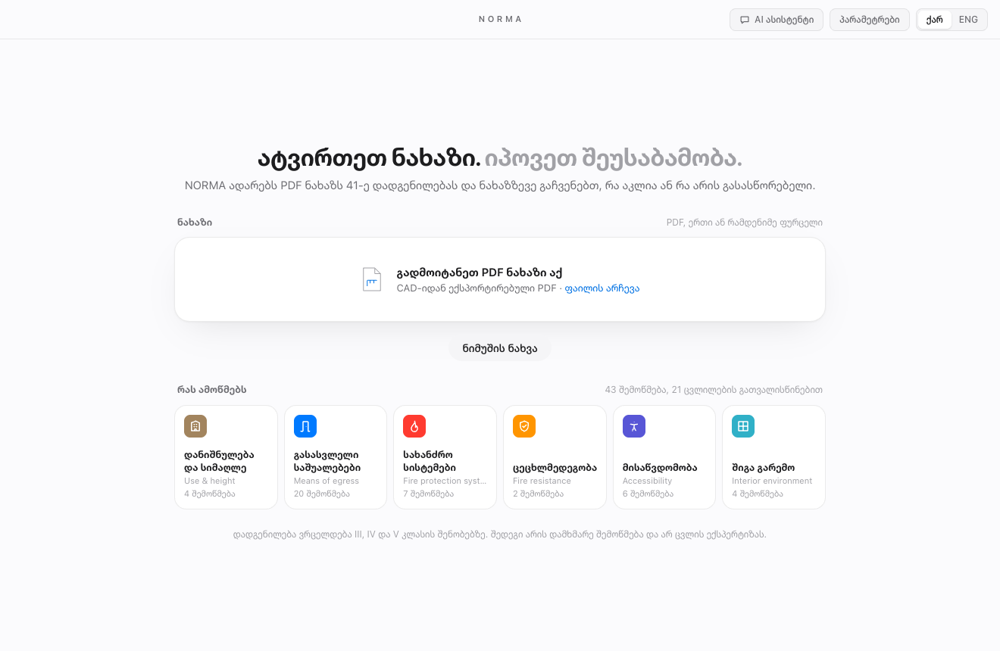

# NORMA

NORMA checks building drawings against **Government of Georgia Resolution №41** (28 January 2016, the Building Safety Rules). Upload a project's PDF, DWG and DXF files, from every discipline, and it reports what breaks the rules, what is missing and what needs checking, and points at each problem on the drawing. It measures DWG and DXF files automatically, floor by floor. An AI assistant answers questions about the regulation and the project. The interface is in Georgian and English.




## How it works

1. **Add files.** Drop files or a whole folder. Each file gets a discipline (architecture, structure, fire protection, water and sewage, heating and ventilation, electrical, low voltage, other), guessed from its name and folder, which you can change.
2. **Read.** Every file becomes sheets in one viewer, grouped by discipline and file. PDFs are read with PyMuPDF. DWG files are converted to DXF with LibreDWG, then drawn with ezdxf; each file runs in its own process, several at a time, so a bad file costs that file and not the project. A sheet is what the designer framed in a layout's viewport, or else a part of model space with clear gaps around it.
3. **Measure.** No AI is involved, so the same file always gives the same numbers. See [Measuring](#measuring).
4. **Check.** With an API key, Google Gemini reviews the sheets (`gemini-3.6-flash` first; when a model is overloaded, stuck or not open to the key, NORMA moves to `gemini-3.8-flash`, `gemini-3.5-flash` and `gemini-3.5-flash-lite`, and keeps to the one that answered) against the rulebook and gives one result per rule: non-compliant, missing, to verify, compliant or not applicable. It gets the measurements too, and cites text on the sheet, so a finding points at the exact place. A project over Gemini's 50 MB limit is sent as lighter images, architecture and fire sheets first.
5. **Report.** The engine builds the report. Clause numbers, requirements and quotes come from the rulebook, not from the model. A measured result replaces the AI's unless the AI found something worse. A rule with no result is listed as "to verify", so silence never counts as a pass.
6. **Review.** Findings are grouped into six categories: use and height, means of egress, fire protection systems, fire resistance, accessibility, and interior environment. Selecting one opens its sheet, zooms in and highlights the place. **By Floor** shows the measurements as a table, and selecting a value shows that place.

Without an API key, DWG and DXF files are still measured and get a report of what the measurements settle, with the other rules left to verify. PDFs need the key. The sample project shows a full report, and the assistant answers from the rulebook and the report, saying that the answer is not from AI. If the AI fails during a check, the measured report still appears, with a notice.

## Measuring

`engine/measure.py` finds things from their shapes, not from layer names, because every office names layers differently.

| What | How | Rules |
| --- | --- | --- |
| Stairs | Parallel lines of one length, evenly spaced at tread distance. Flight width, tread, and the riser from labels like `20R x 16` | 1009.4, 1009.7.2, 1021.2 |
| Levels | Marks like `+32.000` | 202 |
| Doors | Quarter arcs with a leaf. Width is the leaf, so clear width is an estimate | 1008.1.1 |
| Stair separation | A map of the walls, walking out from each stair to its room. Given both ways: between outer walls and between interiors | 403.5.1 |
| Corridor, dead end | The open space most doors open onto. Its width comes from the middle line; the dead end is the corridor beyond the route between the stairs | 1018.2, 1018.4 |
| Sprinklers, cabinets, landing valves | Blocks named or layered as such | Shown in the table only |

Stairs and levels are read directly. The wall map gives estimates, so it never fails a rule alone: a duct or a column can look like a narrow corridor. The widest reading across a floor's disciplines counts, because extra lines can only narrow the map. On a real 27-storey plan it gave stair separation of 9.1 m and 8.5 m, the same as measuring by hand. It does not read rotated viewports, and a sheet with no door arcs gets no corridor.

## The regulation

- `engine/rulebook.py` holds the checks that can be made from drawings. It is a selection, not the whole regulation.
- `engine/data/regulation/` holds the public 2016 text and all 21 amending resolutions from [matsne.gov.ge](https://matsne.gov.ge/ka/document/view/3176389), up to №426 of 4 September 2026. Matsne's consolidated text is paid, so the current wording was worked out from the amendments.
- `test_rulebook.py` fails if a quote in the rulebook is not word for word in the document it names.
- When the regulation changes, add the amendment there and review the rules it touches.

The resolution applies to class III, IV and V buildings. NORMA is an aid for designers: results need checking by a specialist, and the permitting authority makes the decision.

## Privacy

With an API key, the project's sheets are sent to Google during a check, and in chat when a report is open. Without a key, nothing leaves the computer. Everything else stays in `~/.norma`, including reports and the API key. Uploaded files are deleted once they are read; their sheets stay in the report.

Under [Google's terms](https://ai.google.dev/gemini-api/terms), content sent with a free key may be used to improve Google's products and may be read by human reviewers, and Google says not to submit confidential information. With a key from a project with billing enabled, prompts and files are not used to improve products. Use a paid key for client drawings.

## Setup

```bash
npm install
python3 -m venv engine/.venv
engine/.venv/bin/python -m pip install -r engine/requirements.txt
brew install libredwg   # to open DWG files; DXF and PDF work without it
```

## Run

```bash
npm run tauri dev
```

The app starts the Python engine on a free local port and stops it on quit. Add a Gemini API key from [Google AI Studio](https://aistudio.google.com/apikey) in **Settings** for the AI review and chat; `GEMINI_API_KEY` in the environment works too. Set `NORMA_MODEL` to pin a model, for example `gemini-4-argon`, which needs a paid key.

To work on the UI in a browser:

```bash
cd engine && .venv/bin/python server.py --port 8100
npm run dev   # http://localhost:1440, /api is proxied to port 8100
```

## Project structure

| Path | What it does |
| --- | --- |
| `src/components/` | Home, Progress, ReportView, Viewer (drawing, pins and sheet list), Measurements, Assistant, Settings |
| `src/lib/` | `api.ts` talks to the engine; `project.ts` collects files and guesses disciplines; `i18n.ts` holds the Georgian and English text |
| `src-tauri/` | Desktop shell: starts and stops the engine |
| `engine/server.py` | Local API: upload, checks, page images, reports, chat |
| `engine/ai.py` | The Gemini calls: review, chat and its regulation search tool, offline answers |
| `engine/report.py` | Turns a review into the report |
| `engine/rulebook.py` | The checks, with clause, requirement and quote |
| `engine/regulation.py` | Search over the regulation and amendments |
| `engine/project.py` | Reads a project's files into one drawing set |
| `engine/cad.py` | DWG and DXF: conversion, sheets, flat geometry, PDF pages. Also the worker for one file |
| `engine/measure.py` | Measurements from CAD geometry, the floor table, and the rules they settle |
| `engine/pdf_tools.py` | Page images and positioned text |
| `engine/build_sample.py` | Builds the sample project in `engine/demo/` (needs `pymupdf-fonts`) |

## Tests

```bash
cd engine
.venv/bin/python -m unittest test_rulebook test_engine test_cad
```

`test_engine.py` runs the real Gemini SDK against a local stand-in for Google's server. `test_cad.py` measures a floor plan it draws itself, so the right answers are known.

## Creators

- **Temo Dzneladze**
- **Elizbar Kheladze**
