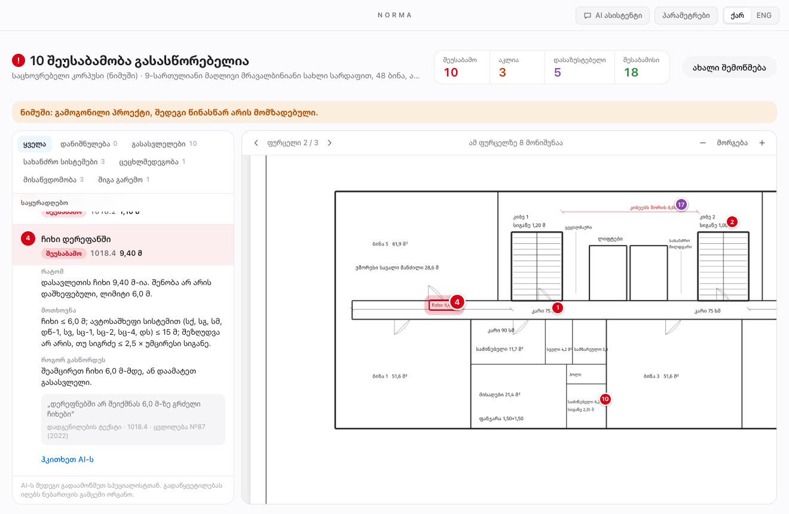

# NORMA

NORMA checks building drawings against **Government of Georgia Resolution №41** (28 January 2016, the Building Safety Rules). Upload a PDF exported from CAD and it reports what breaks the rules, what is missing and what needs checking, and points at each problem on the drawing. An AI assistant answers questions about the regulation and the project. The interface is in Georgian and English.




## How it works

1. **Read.** The engine reads the PDF's pages and its positioned text (PyMuPDF). A PDF over Gemini's 50 MB limit is sent as a lighter copy with smaller images; the app keeps showing the original.
2. **Check.** Google Gemini reviews the sheets (`gemini-3.6-flash` first; when a model is overloaded, stuck or not open to the key, NORMA moves to `gemini-3.8-flash`, `gemini-3.5-flash` and `gemini-3.5-flash-lite`, and keeps to the one that answered) against the rulebook and gives one result per rule: non-compliant, missing, to verify, compliant or not applicable. It cites text on the sheet, so a finding points at the exact place.
3. **Report.** The engine builds the report. Clause numbers, requirements and quotes come from the rulebook, not from the model. A rule with no result is listed as "to verify", so silence never counts as a pass.
4. **Review.** Findings are grouped into six categories: use and height, means of egress, fire protection systems, fire resistance, accessibility, and interior environment. Selecting one opens its sheet, zooms in and highlights the place.

Without an API key, the sample project still shows a full report, and the assistant answers from the rulebook and the report, saying that the answer is not from AI.

## The regulation

- `engine/rulebook.py` holds the checks that can be made from drawings. It is a selection, not the whole regulation.
- `engine/data/regulation/` holds the public 2016 text and all 21 amending resolutions from [matsne.gov.ge](https://matsne.gov.ge/ka/document/view/3176389), up to №426 of 4 September 2026. Matsne's consolidated text is paid, so the current wording was worked out from the amendments.
- `test_rulebook.py` fails if a quote in the rulebook is not word for word in the document it names.
- When the regulation changes, add the amendment there and review the rules it touches.

The resolution applies to class III, IV and V buildings. NORMA is an aid for designers: results need checking by a specialist, and the permitting authority makes the decision.

## Privacy

During a check the PDF is sent to Google, and in chat when a report is open. Everything else stays in `~/.norma`, including reports and the API key.

Under [Google's terms](https://ai.google.dev/gemini-api/terms), content sent with a free key may be used to improve Google's products and may be read by human reviewers, and Google says not to submit confidential information. With a key from a project with billing enabled, prompts and files are not used to improve products. Use a paid key for client drawings.

## Setup

```bash
npm install
python3 -m venv engine/.venv
engine/.venv/bin/python -m pip install -r engine/requirements.txt
```

## Run

```bash
npm run tauri dev
```

The app starts the Python engine on a free local port and stops it on quit. Add a Gemini API key from [Google AI Studio](https://aistudio.google.com/apikey) in **Settings** to run real checks and AI chat; `GEMINI_API_KEY` in the environment works too. Set `NORMA_MODEL` to pin a model, for example `gemini-4-argon`, which needs a paid key.

To work on the UI in a browser:

```bash
cd engine && .venv/bin/python server.py --port 8100
npm run dev   # http://localhost:1440, /api is proxied to port 8100
```

## Project structure

| Path | What it does |
| --- | --- |
| `src/components/` | Home, Progress, ReportView, Viewer (drawing and pins), Assistant, Settings |
| `src/lib/` | `api.ts` talks to the engine; `i18n.ts` holds the Georgian and English text |
| `src-tauri/` | Desktop shell: starts and stops the engine |
| `engine/server.py` | Local API: upload, checks, page images, reports, chat |
| `engine/ai.py` | The Gemini calls: review, chat and its regulation search tool, offline answers |
| `engine/report.py` | Turns a review into the report |
| `engine/rulebook.py` | The checks, with clause, requirement and quote |
| `engine/regulation.py` | Search over the regulation and amendments |
| `engine/pdf_tools.py` | Page images and positioned text |
| `engine/build_sample.py` | Builds the sample project in `engine/demo/` (needs `pymupdf-fonts`) |

## Tests

```bash
cd engine
.venv/bin/python -m unittest test_rulebook test_engine
```

`test_engine.py` runs the real Gemini SDK against a local stand-in for Google's server.

## Creators

- **Temo Dzneladze**
- **Elizbar Kheladze**
